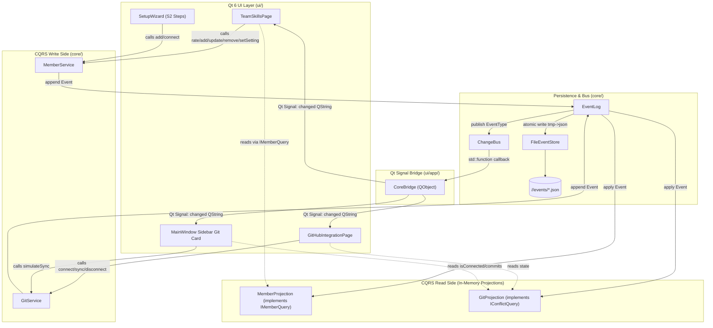
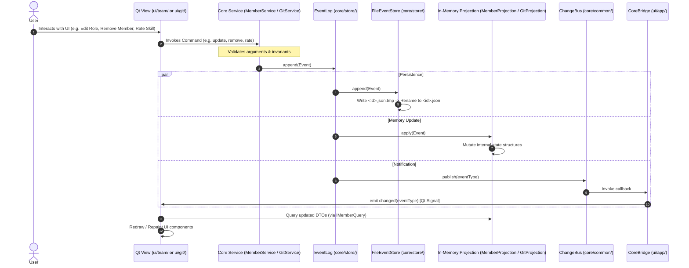

# Planova — Full Architecture & S2 Audit

> **Branch:** `feature/s2-team-git`  
> **Course:** Software Engineering 2 + OOP | Team of 6  
> **Target Technology:** C++17 · Qt 6.8.3 (Widgets & Core) · CMake · Local Event Sourcing (No SQL)  
> **Lead Focus:** Slice 2 (S2) — Team Profiles, Skill Ratings, Velocity Tracking & Git Integration

---

## Executive Summary

**Planova** is a desktop project management application engineered in pure C++17 and Qt 6 Widgets using a **CQRS and local Event Sourcing architecture** without any SQL database or external backend. Every mutation is persisted as an append-only JSON event file (`<timestamp>-<hash8>.json`) in a local workspace directory. On startup, event logs are replayed into in-memory projections.

This document serves as the comprehensive architectural reference and deep technical audit of the codebase on the `feature/s2-team-git` branch, with granular examination of **Slice 2 (S2)** and its interactions with **S1 (Foundation)**, **S3 (Tasks)**, **S4 (Chaos Slicer)**, and **S6 (Stats & Analytics)**.

---

## Table of Contents

1. [Project Overview & Architecture](#1-project-overview--architecture)
   - [1.1 CQRS & Local Event Sourcing](#11-cqrs--local-event-sourcing)
   - [1.2 Project Layout & Target Structure](#12-project-layout--target-structure)
   - [1.3 Core Dependencies & Constraints](#13-core-dependencies--constraints)
   - [1.4 Strictly Light-Mode Theme Architecture](#14-strictly-light-mode-theme-architecture)
2. [S2 Component Map](#2-s2-component-map)
   - [2.1 S2 Domain & Core Layer (`core/planova/team/` and `core/planova/git/`)](#21-s2-domain--core-layer)
   - [2.2 S2 UI Layer — Deep Dive (`ui/team/` & `ui/git/`)](#22-s2-ui-layer--deep-dive)
   - [2.3 S2 Ingestion in S1 Shell (`ui/welcome/SetupWizard.cpp`)](#23-s2-ingestion-in-s1-shell-setupwizardcpp)
   - [2.4 S2 Ingestion in S1 Shell (`ui/app/MainWindow.cpp`)](#24-s2-ingestion-in-s1-shell-mainwindowcpp)
   - [2.5 S2 Event Definitions & Payloads](#25-s2-event-definitions--payloads)
   - [2.6 S2 Test Suite Analysis](#26-s2-test-suite-analysis)
3. [Data Flow Matrix](#3-data-flow-matrix)
   - [3.1 End-to-End CQRS Cycle Diagram](#31-end-to-end-cqrs-cycle-diagram)
   - [3.2 Granular Action-to-Event-to-UI Mapping](#32-granular-action-to-event-to-ui-mapping)
   - [3.3 Velocity Tracking Loop via `TaskMoved` Events](#33-velocity-tracking-loop-via-taskmoved-events)
   - [3.4 `CoreBridge` Signal Dispatch Mechanism](#34-corebridge-signal-dispatch-mechanism)
4. [Cross-Slice Dependencies](#4-cross-slice-dependencies)
   - [4.1 Global Inter-Slice Contract Diagram](#41-global-inter-slice-contract-diagram)
   - [4.2 Consumption by S4 (Chaos Slicer)](#42-consumption-by-s4-chaos-slicer)
   - [4.3 Consumption by S6 (Stats & Leaderboard)](#43-consumption-by-s6-stats--leaderboard)
   - [4.4 Cross-Slice Consumption by S2 (S3 Tasks & S5 Conflicts)](#44-cross-slice-consumption-by-s2-s3-tasks--s5-conflicts)
   - [4.5 `PlanovaCore` Orchestration Root](#45-planovacore-orchestration-root)
5. [Execution & Build Instructions](#5-execution--build-instructions)
   - [5.1 Environment Prerequisites](#51-environment-prerequisites)
   - [5.2 Building with CMake CLI](#52-building-with-cmake-cli)
   - [5.3 Building with Qt Creator](#53-building-with-qt-creator)
   - [5.4 Running the Test Suite via CTest](#54-running-the-test-suite-via-ctest)
   - [5.5 Audit Verification & Quality Checklist](#55-audit-verification--quality-checklist)

---

## 1. Project Overview & Architecture

### 1.1 CQRS & Local Event Sourcing

Planova replaces relational databases and ORMs with a **pure event sourcing engine**:



#### Key Architectural Axioms:
1. **Append-Only Immutable Event Files:** Every state mutation produces an `Event` object containing `{ id, ts, author, type, payload }`. Events are serialized as compact JSON files named `<timestamp>-<hash8>.json` where `<hash8>` is computed from `QCryptographicHash::Sha256(author + payload)`.
2. **Conflict-Free Git Merging:** Because each event is written as an atomically created file (`.tmp` renamed to `.json`), multiple teammates committing events to git never collide in git line merges. Replaying directory entries sorted by `(ts, id)` yields identical deterministic state across all distributed nodes.
3. **Strict CQRS Separation:** Services (`MemberService`, `GitService`) only receive write commands and append events. They never return query state. In-memory projections (`MemberProjection`, `GitProjection`) subscribe to the `EventLog`, maintain the cached runtime state, and expose read-only interfaces (`IMemberQuery`, `IConflictQuery`).
4. **Decoupled Cross-Slice Communication:** Cross-slice reads are strictly gated through abstract interface structs declared in [Queries.h](file:///E:/College/Planova.anti/core/include/planova/common/Queries.h). No slice may directly include private headers of another slice.

---

### 1.2 Project Layout & Target Structure

```
Planova.anti/
├── CMakeLists.txt                      # Root configuration (find_package Qt6 Core Widgets Test)
├── core/                               # Backend logic (Links ONLY Qt6::Core)
│   ├── CMakeLists.txt                  # Defines static library: planova_core
│   ├── include/planova/
│   │   ├── common/                     # Phase 0 shared contracts (Types, Event, Dtos, Queries, etc.)
│   │   ├── store/                      # FileEventStore.h, EventLog.h
│   │   ├── project/                    # Project domain (S1)
│   │   ├── team/                       # Team, Member, Velocity, Skill domain (S2)
│   │   ├── git/                        # Git connection, Commit, Issue domain (S2)
│   │   ├── slicer/                     # Chaos Slicer algorithms & weights (S4)
│   │   └── PlanovaCore.h               # Top-level composition root
│   └── src/                            # Implementation files mirroring include/
├── ui/                                 # GUI layer (Links planova_core, Qt6::Widgets)
│   ├── CMakeLists.txt                  # Defines static library: planova_ui and executable: planova
│   ├── app/                            # main.cpp, MainWindow.h/.cpp, CoreBridge.h/.cpp
│   ├── theme/                          # Tokens.h, ThemeManager.h/.cpp
│   ├── widgets/                        # Shared reusable widgets (AvatarBadge)
│   ├── welcome/                        # WelcomePage, ProjectsHubPage, SetupWizard
│   ├── team/                           # S2: TeamSkillsPage.h/.cpp
│   ├── git/                            # S2: GitHubIntegrationPage.h/.cpp
│   └── slicer/                         # S4: ChaosSlicerPage, PizzaWidget, Tables
├── resources/                          # Qt Resource file (planova.qrc) & Light QSS
│   ├── planova.qrc
│   └── themes/light/
│       ├── base.qss                    # Global UI styles (Fusion palette, fonts, buttons)
│       └── slicer.qss                  # Slicer and directory card styles
└── tests/                              # CTest unit & integration tests
    ├── CMakeLists.txt                  # Defines test runners linking Qt6::Test & planova_core
    ├── fakes/                          # FakeClock.h, FakeEventStore.h
    ├── tst_MemberService.cpp           # S2 Unit tests (Members, roles, removal, ratings)
    ├── tst_Velocity.cpp                # S2 Unit tests (EMA calculation, bounds)
    ├── tst_GitService.cpp              # S2 Unit tests (Connect, sync, conflict detection)
    ├── tst_FileEventStore.cpp          # S1 Unit tests
    ├── tst_EventLog.cpp                # S1 Unit tests
    └── tst_ProjectService.cpp          # S1 Unit tests
```

---

### 1.3 Core Dependencies & Constraints

| Dependency / System | Specification | Architectural Guardrail |
|---------------------|---------------|-------------------------|
| **C++ Standard** | C++17 (`set(CMAKE_CXX_STANDARD 17)`) | Standard library algorithms, `std::optional`, `std::filesystem`, structured bindings. |
| **Qt 6 Framework** | Qt 6.8.3 LTS (MinGW 64-bit / MSVC) | `Qt6::Core` for backend; `Qt6::Widgets` for UI; `Qt6::Test` for testing. |
| **No Database / SQL** | Pure Event Files on Disk | Zero SQLite, ODBC, or SQL drivers. Storage is entirely handled by `FileEventStore`. |
| **Display-Free Core** | `planova_core` isolation | Never includes `<QWidget>`, `<QPainter>`, or `<QApplication>`. Pure headless testability. |
| **Light-Only Theme** | Strict token mapping | Grepping for raw `#HEX` in `core/` or `ui/` outside of `Tokens.h` or `*.qss` is disallowed. |

---

### 1.4 Strictly Light-Mode Theme Architecture

The UI styling is governed by [Tokens.h](file:///E:/College/Planova.anti/ui/theme/Tokens.h) and loaded through [ThemeManager.cpp](file:///E:/College/Planova.anti/ui/theme/ThemeManager.cpp). Planova enforces the **Light Mode First** principle:
- `Token::Background` (`#FAF8F5`): Master background for pages.
- `Token::Surface` (`#FFFFFF`): Member profile cards, connection frames.
- `Token::SurfaceAlt` (`#F5F2EA`): Secondary buttons, table fills.
- `Token::Border` (`#E7E2D6`): Card outlines and dividers.
- `Token::Accent` (`#5438DC`): Primary button fills, active rating buttons.
- `Token::SuccessSoft` (`#D4F981`): "Connected" badge background.
- `Token::Member1` through `Member6`: Dynamic member avatar badges.

---

## 2. S2 Component Map

### 2.1 S2 Domain & Core Layer

#### 1. Skill Categories ([SkillCategory.h](file:///E:/College/Planova.anti/core/include/planova/team/SkillCategory.h))
7 disciplines: `Backend`, `Frontend`, `Storage`, `UiUx`, `Integration`, `Testing`, `Documentation`. Bidirectional string conversions via `toString()` and `fromString()`.

#### 2. Member Entity Model ([Member.h](file:///E:/College/Planova.anti/core/include/planova/team/Member.h))
Represents a team member: `{ id, name, role, isLead, ratings, understanding, velocity }`.

#### 3. Member Service ([MemberService.h](file:///E:/College/Planova.anti/core/include/planova/team/MemberService.h) / [MemberService.cpp](file:///E:/College/Planova.anti/core/src/team/MemberService.cpp))
Handles all team command mutations:
- `Id add(name, role, isLead)`: Appends `MemberAdded`.
- `void update(id, role, understanding)`: Appends `MemberUpdated`.
- `void remove(id)`: Validates non-empty ID, appends `MemberRemoved`.
- `void rate(id, category, rating)`: Bounds check `1..5`, appends `SkillRated`.
- `void setSetting(key, value)`: Appends `SettingChanged`.

#### 4. Member Projection ([MemberProjection.h](file:///E:/College/Planova.anti/core/include/planova/team/MemberProjection.h) / [MemberProjection.cpp](file:///E:/College/Planova.anti/core/src/team/MemberProjection.cpp))
Implements `IProjection` and `IMemberQuery`. Handles:
- `MemberAdded`: Inserts new member in `members_` and `memberOrder_`.
- `MemberUpdated`: Updates role and understanding.
- `MemberRemoved`: Erases from `members_` and `memberOrder_`.
- `SkillRated`: Updates ratings map.
- `TaskMoved`: Recomputes velocity.

#### 5. Velocity Calculator ([VelocityCalculator.h](file:///E:/College/Planova.anti/core/include/planova/team/VelocityCalculator.h))
Calculates rolling performance multipliers using EMA ($\alpha = 0.3$), clamped to $[0.5, 2.0]$.

#### 6. Git Service & Projection ([GitService.h](file:///E:/College/Planova.anti/core/include/planova/git/GitService.h) / [GitProjection.h](file:///E:/College/Planova.anti/core/include/planova/git/GitProjection.h))
Handles repository connect/sync/disconnect operations and simulates realistic commit histories using registered team member names. Implements `IConflictQuery`.

---

### 2.2 S2 UI Layer — Deep Dive

#### 1. `TeamSkillsPage` ([ui/team/TeamSkillsPage.cpp](file:///E:/College/Planova.anti/ui/team/TeamSkillsPage.cpp))
- **Role Selection Dropdown + Custom "Other..." Input:**
  - Standardized list of known engineering roles (`Backend Developer`, `Frontend Developer`, `Full Stack Developer`, `UI / UX Designer`, `Database Architect`, `QA / Testing Engineer`, `Integration & DevOps`, `Technical Documentation`, `Team & Systems Lead`, `Other...`).
  - Selecting `Other...` reveals a companion text field to write any custom role.
- **Card In-Line Role Editing (`✎ Edit Role`):**
  - Clicking `✎ Edit Role` transforms the role subtitle into an in-line dropdown and custom text field with `Save` and `Cancel` buttons.
- **Member Removal (`✕ Remove`):**
  - Prompts a confirmation dialog before appending `MemberRemoved` and recalculating all summary telemetry.
- **7-Domain Skill Matrix:**
  - Clickable buttons `1` to `5` for all seven disciplines.
- **Understanding Slider:**
  - Real-time `QSlider` (0–100%) committing updates on release.
- **"Seed Demo Team" Shortcut:**
  - Instantly seeds 5 pre-configured team profiles (*Adam, Zeyad, Hazem, Mai, Basma*).

#### 2. `GitHubIntegrationPage` ([ui/git/GitHubIntegrationPage.cpp](file:///E:/College/Planova.anti/ui/git/GitHubIntegrationPage.cpp))
- Connection card with status badge.
- Live commits table (Hash, Message, Author, Timestamp).
- Issues table with colored state chips.
- "Simulate Git Sync" button.

---

### 2.3 S2 Ingestion in S1 Shell

- **`SetupWizard.cpp` (Step 4 & 8):** Embeds `TeamSkillsWizardPage` featuring the known roles dropdown and custom role field, plus `GitSyncWizardPage`.
- **`MainWindow.cpp`:** Registers `TeamSkillsPage` (index 4) and `GitHubIntegrationPage` (index 7), binds status bar telemetry to member counts, and embeds the **Sidebar Git Sync Status Card**.

---

### 2.4 S2 Event Definitions & Payloads

Declared in [EventTypes.h](file:///E:/College/Planova.anti/core/include/planova/common/EventTypes.h):
- `MemberAdded`: `{"memberId", "name", "role", "isLead"}`
- `MemberUpdated`: `{"memberId", "role", "understanding"}`
- `MemberRemoved`: `{"memberId"}`
- `SkillRated`: `{"memberId", "category", "rating"}`
- `SettingChanged`: `{"key", "value"}`
- `GitConnected`: `{"repoUrl", "branch"}`
- `GitDisconnected`: `{}`
- `GitSynced`: `{"commits", "issues", "conflictedMembers"}`

---

### 2.5 S2 Test Suite Analysis

- `tst_MemberService.cpp`: Validates creation, name validation, understanding clamping, rating bounds, removal persistence, and settings reload.
- `tst_Velocity.cpp`: Tests EMA formula blending, bounds clamping, zero-hour protection, and `TaskMoved` updates.
- `tst_GitService.cpp`: Tests connect/sync/disconnect cycles, commit/issue/conflict parsing, and simulation.

---

## 3. Data Flow Matrix

### 3.1 End-to-End CQRS Cycle Diagram



---

## 4. Cross-Slice Dependencies

- **S4 (Chaos Slicer):** Consumes `IMemberQuery` for skill scoring (`rating / 5.0`) and velocity multipliers. Consumes `MemberDto` for `PizzaPortionCalculator`.
- **S6 (Stats & Leaderboard):** Consumes `IMemberQuery` for the Fair Leaderboard and Project Home contribution bars.
- **S3 (Phase Board) → S2:** Emits `TaskMoved` events that S2's `MemberProjection` intercepts to drive `VelocityCalculator`.
- **S5 (Conflicts) ↔ S2:** S2's `GitProjection` implements `IConflictQuery`.

---

## 5. Execution & Build Instructions

```powershell
# Build solution
$env:PATH = "C:\Qt\6.8.3\mingw_64\bin;C:\Qt\Tools\mingw1310_64\bin;C:\Qt\Tools\CMake_64\bin;$env:PATH"
cmake --build "E:\College\Planova.anti\build\Desktop_Qt_6_8_3_MinGW_64_bit_Debug" --target planova

# Run application
.\build\Desktop_Qt_6_8_3_MinGW_64_bit_Debug\ui\planova.exe

# Run test suite
ctest --test-dir "E:\College\Planova.anti\build\Desktop_Qt_6_8_3_MinGW_64_bit_Debug" --output-on-failure
```

---

*End of Architecture & S2 Audit Document.*
