<div align="center">


# Planova

**Project planning for student software teams.**

A desktop app for splitting work fairly, tracking who did what, and handing tasks off without losing context.


</div>

<p align="center">
  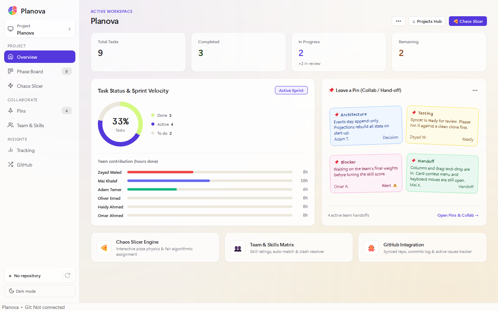
</p>

## What it does

Planova follows a student project from setup to delivery:

- **Guided setup.** A six-step wizard sets the project name, the process model (Agile, Scrum, Waterfall or Spiral), the
  team and their skills, the slicer policy and the repository.
- **Phase Board.** A Kanban board with To Do, In Progress, Review / QA and Done columns. Each card moves to the next
  phase with one click, and the assignee can decline a task from its menu. The board has search and a member filter.
- **Chaos Slicer.** Splits the tasks between members using weighted skill match, workload levelling and priority, then
  shows the result as a pizza chart. You can override any assignment before applying it to the board.
- **Team & Skills.** Each member is rated 1 to 5 in seven skill areas (Backend, Frontend, Storage, UI/UX, Integration,
  Testing, Documentation), with understanding and velocity tracked per member.
- **Pins.** Short notes for handoffs, blockers, testing and decisions, linked to tasks and members.
- **Fair tracking.** A leaderboard weighted by task complexity, so a pile of trivial tasks does not outrank one hard one.
- **GitHub page.** Commits, issues and conflict alerts per member. The data is simulated for now (see
  [Known limitations](docs/README.md#known-limitations)).
- **Light and dark themes.** Switch from the sidebar. On first run the app follows the system setting.

## Screenshots

<table>
  <tr>
    <td width="50%">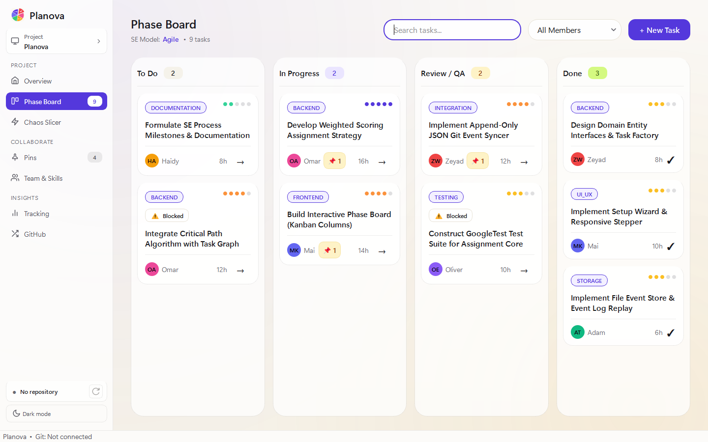<br><sub><b>Phase Board</b>: tasks by phase, with complexity dots, owners and pins</sub></td>
    <td width="50%">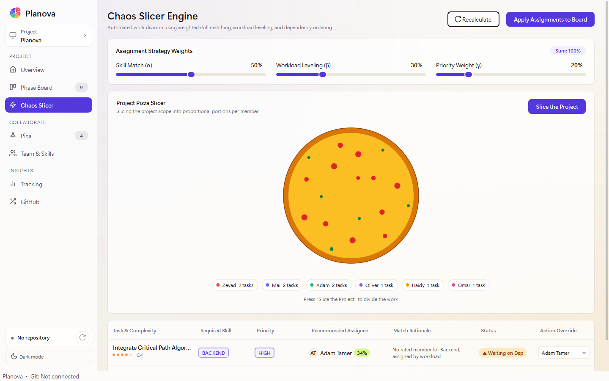<br><sub><b>Chaos Slicer</b>: adjustable weights and a per-member split of the work</sub></td>
  </tr>
  <tr>
    <td>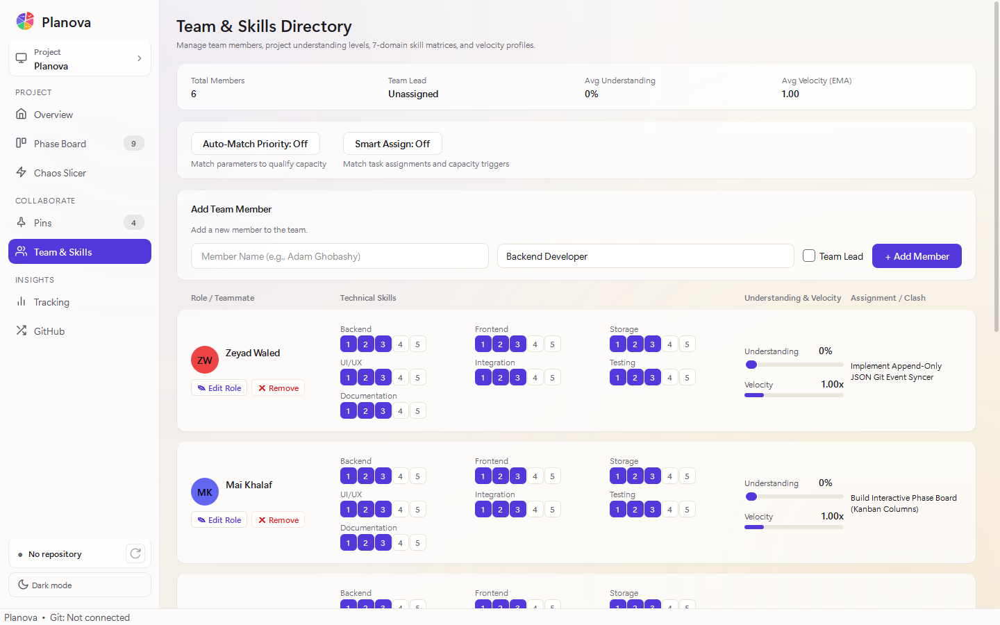<br><sub><b>Team & Skills</b>: seven-area skill matrix with understanding and velocity</sub></td>
    <td>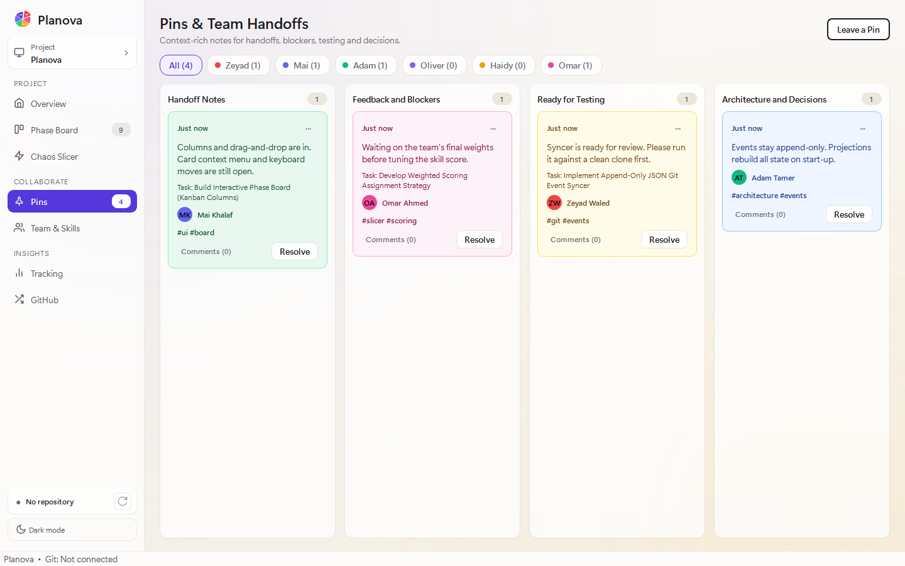<br><sub><b>Pins</b>: handoff notes, blockers, testing and decisions</sub></td>
  </tr>
  <tr>
    <td>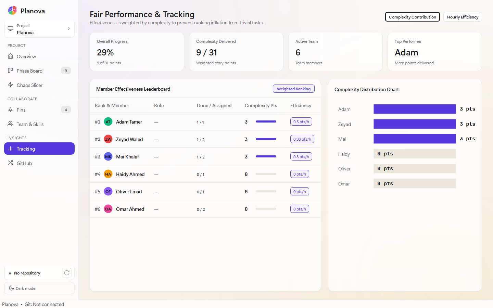<br><sub><b>Tracking</b>: complexity-weighted leaderboard and distribution chart</sub></td>
    <td>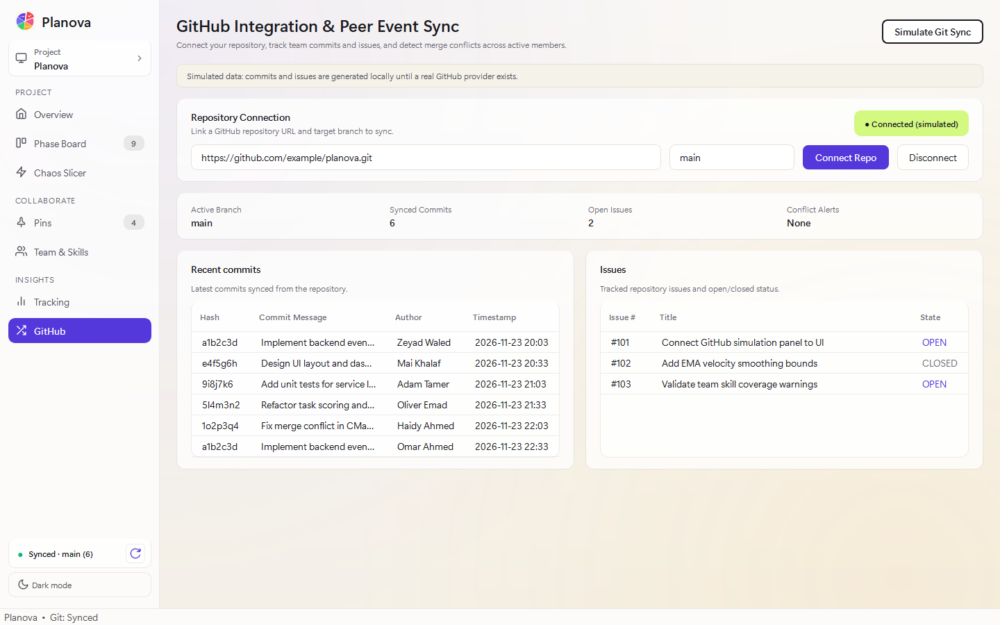<br><sub><b>GitHub</b>: synced commits, issues and conflict alerts (simulated)</sub></td>
  </tr>
  <tr>
    <td>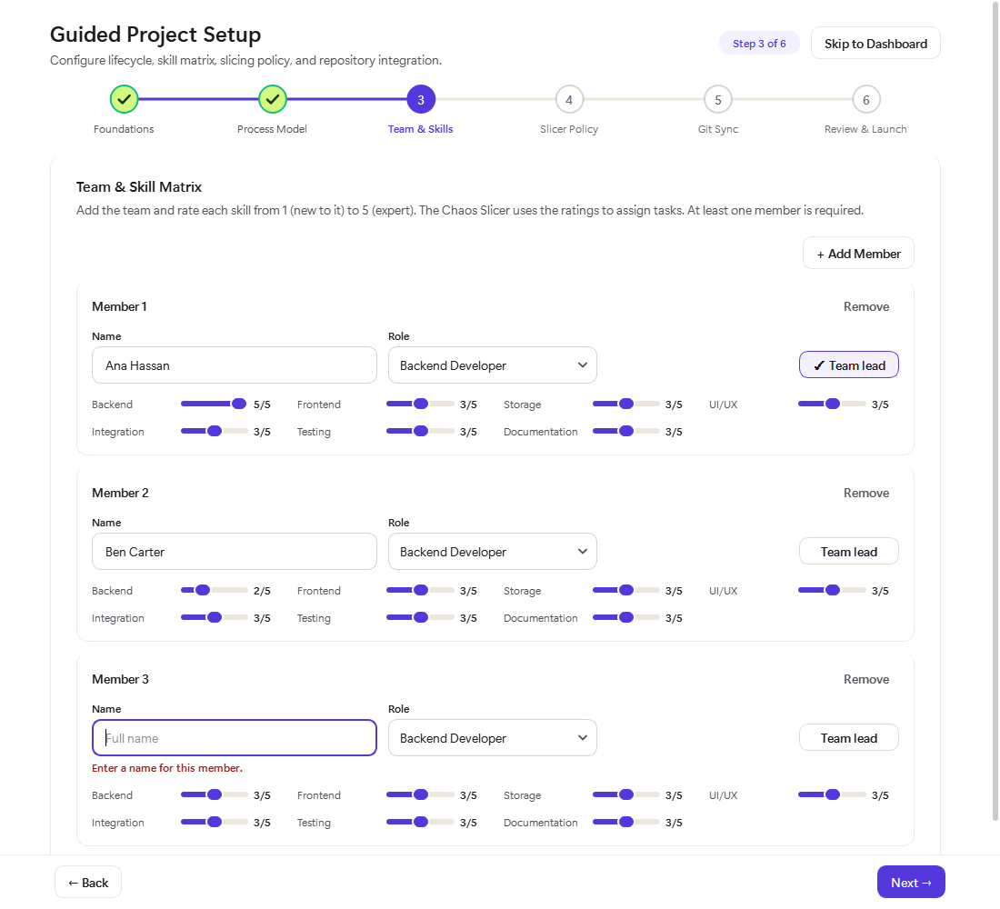<br><sub><b>Setup wizard</b>: step 3, the team and skill matrix, with inline validation</sub></td>
    <td>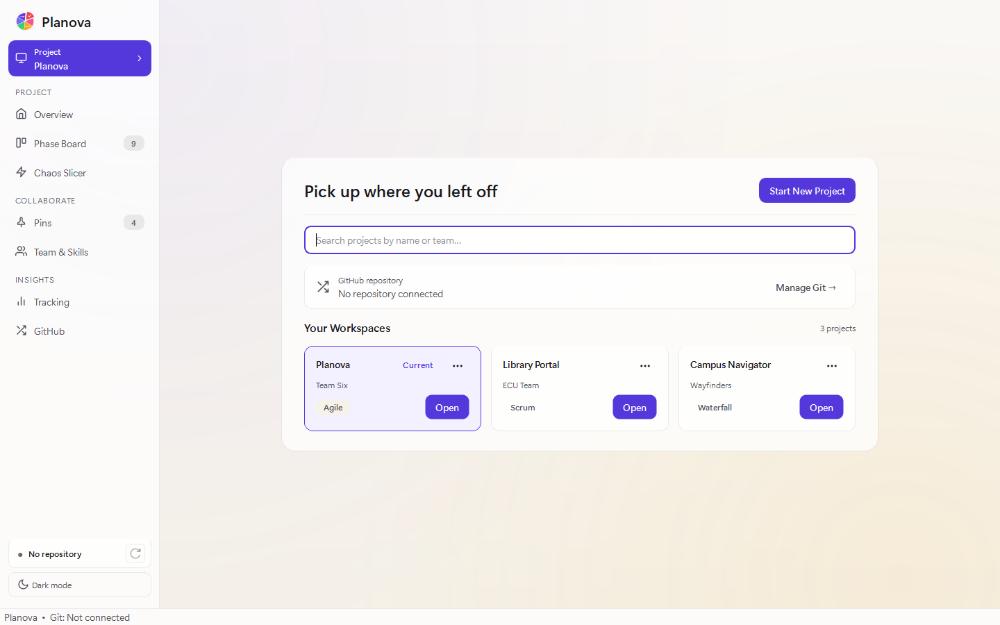<br><sub><b>Projects Hub</b>: switch between projects or start a new one</sub></td>
  </tr>
</table>

### Dark mode

<table>
  <tr>
    <td width="50%">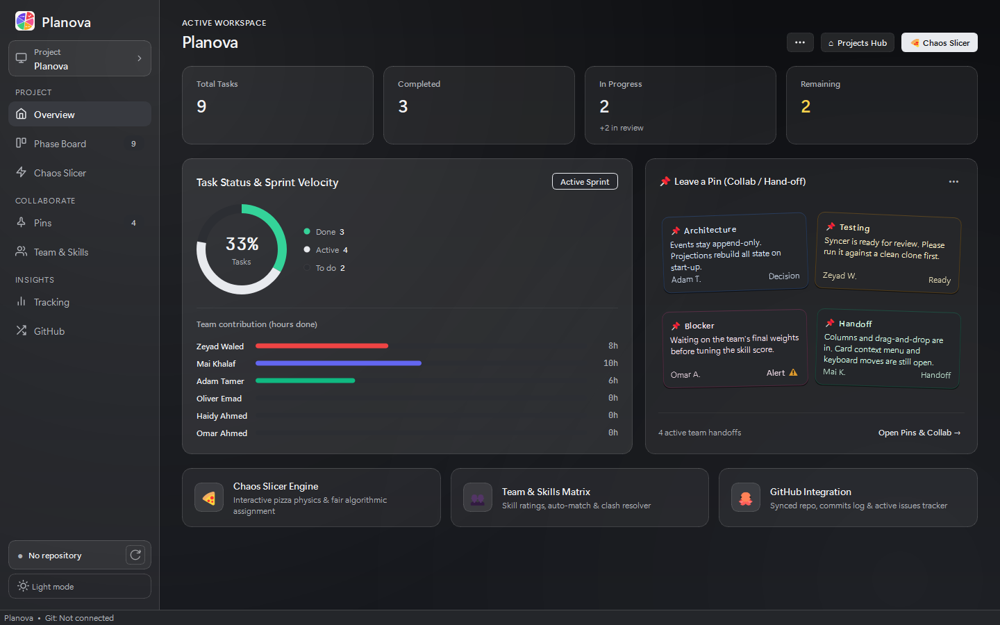</td>
    <td width="50%">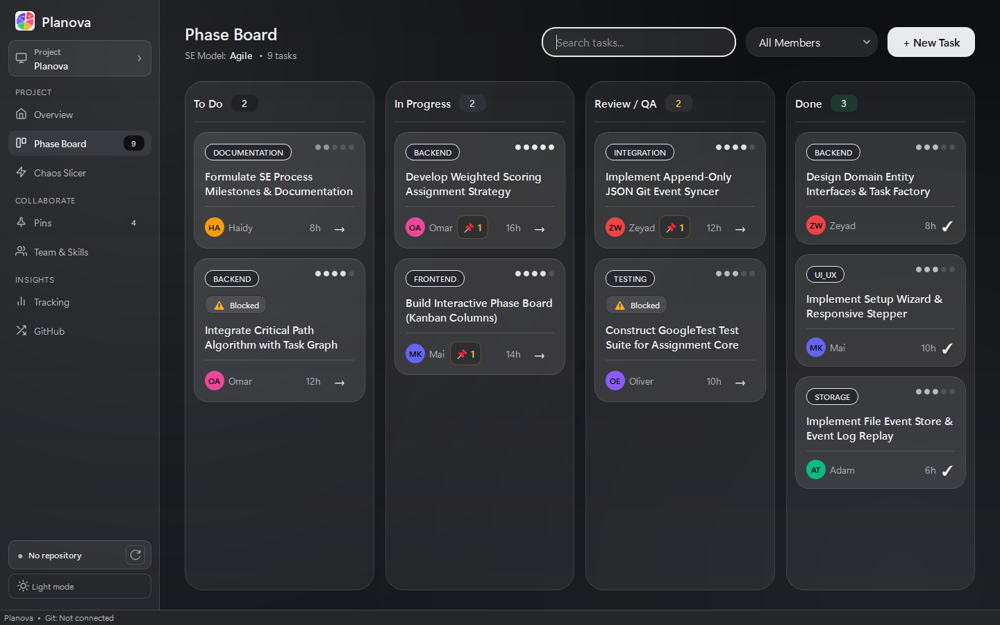</td>
  </tr>
</table>

## Tech stack

| Area | Choice |
|------|--------|
| Language | C++17 |
| UI | Qt 6.8 Widgets with the Fusion style, custom-painted charts and cards |
| Build | CMake 3.16+, Ninja, MinGW 64-bit (GCC 13) |
| Tests | Qt Test, run through CTest (53 test executables, core and UI) |
| Storage | Append-only JSON event files. No database. |
| Theming | One token table for light and dark colours, QSS templates with `@Token` placeholders |
| Fonts | Inter, Space Grotesk and JetBrains Mono, bundled as Qt resources |

The app has no third-party libraries. Everything uses Qt and the C++ standard library.

## Architecture

Planova is event sourced. Every change is written as an event file, and the app rebuilds its state by replaying those
events in `(timestamp, id)` order on start.

```
  UI page ──calls──▶ Service ──validates, then appends──▶ Event store (events/*.json)
     ▲                                                          │
     │ reads via query interfaces                                ▼
     └──────── refresh on CoreBridge::changed ◀──────── Projections (in-memory state)
```

- **`core/`** holds the domain logic and links only `Qt6::Core`. Services reject bad input with
  `std::invalid_argument` and append nothing in that case. Projections hold the current state. Strategies such as
  `IAssignmentStrategy` sit behind interfaces so they can be swapped.
- **`ui/`** holds the Qt Widgets pages. Pages never touch events directly. They call services and read through query
  interfaces.

Because each event file has a unique name and is never edited, a team can share a project through git without merge
conflicts on the data. [docs/README.md](docs/README.md#sync-data-with-the-team) explains how.

## Getting started

### Requirements

- Windows
- Qt 6.8.3 for MinGW 64-bit (`C:/Qt/6.8.3/mingw_64`)
- The MinGW 13.1 toolchain, CMake and Ninja that come with the Qt installer

### Build and test

From the repository root in Git Bash:

```bash
export PATH="/c/Qt/Tools/CMake_64/bin:/c/Qt/Tools/Ninja:/c/Qt/Tools/mingw1310_64/bin:/c/Qt/6.8.3/mingw_64/bin:$PATH"
cmake -S . -B build -G Ninja -DCMAKE_PREFIX_PATH=C:/Qt/6.8.3/mingw_64   # first time only
cmake --build build && (cd build && ctest --output-on-failure)
```

### Run

```bash
build/ui/planova.exe          # open the most recent project
build/ui/planova.exe --demo   # fill an empty project with a sample team, tasks and pins
```

Project data is stored in `Documents/Planova`, one folder per project.

## Project structure

```
planova/
├── core/                  Domain logic (Qt6::Core only)
│   ├── include/planova/   Public headers: task, team, slicer, pins, git, stats, store, ...
│   └── src/
├── ui/                    Qt Widgets app
│   ├── app/               Main window, sidebar, splash, CoreBridge
│   ├── board/ slicer/ pins/ team/ tracking/ git/ home/ welcome/
│   ├── theme/             Tokens and ThemeManager
│   └── widgets/           Shared widgets
├── resources/             Icons, fonts, QSS themes
├── tests/                 Qt Test suites for core and UI
├── tools/screenshots/     Saves PNGs of every page in both themes
└── docs/                  Developer guide, process, milestones, architecture
```

## Documentation

- [Developer guide](docs/README.md): flags, data location, team sync, screenshot tool, fonts and known limitations
- [Software engineering process](docs/SE_Process.md)
- [Milestones](docs/Milestones.md)
- [Architecture audit](docs/architecture/Planova_Full_Architecture_Audit.md)
