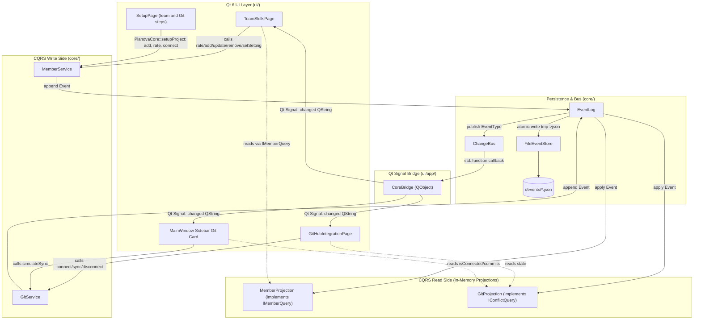
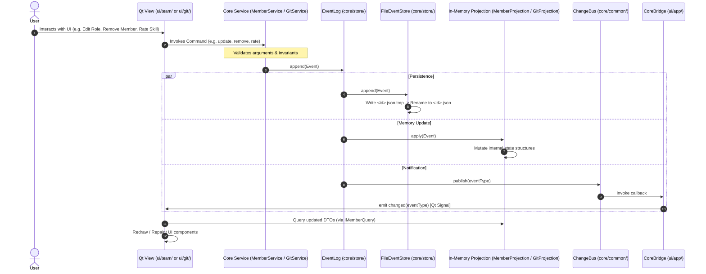

# Planova: Architecture and Slice Audit

> **Branch:** `feature/full-completion`  
> **Course:** Software Engineering 2 + OOP | Team of 6  
> **Technology:** C++17 · Qt 6.8.3 (Widgets and Core) · CMake · Local event sourcing (no SQL)  
> **Focus:** how the six slices fit together, with the detailed component map of Slice 2 (S2): team profiles, skill ratings, velocity and simulated GitHub

---

## Executive Summary

**Planova** is a desktop project management application written in C++17 and Qt 6 Widgets. It uses **CQRS and local event sourcing** with no SQL database and no external backend. Every change is stored as an append-only JSON event file (`<timestamp>-<hash8>.json`) in a local workspace folder. On start, the event files are replayed into in-memory projections.

This document is the architecture reference for the final state of the project. It covers all six slices: **S1** (foundation, theme, shell, welcome and setup), **S2** (team, skills, velocity, simulated GitHub), **S3** (tasks and board), **S4** (Chaos Slicer), **S5** (pins and conflicts) and **S6** (stats, home, tracking). The component map in section 2 goes deeper into S2. For the process and the slice boundaries see [SE_Process.md](../SE_Process.md); for what was delivered per week see [Milestones.md](../Milestones.md).

---

## Table of Contents

1. [Project Overview & Architecture](#1-project-overview--architecture)
   - [1.1 CQRS & Local Event Sourcing](#11-cqrs--local-event-sourcing)
   - [1.2 Project Layout & Target Structure](#12-project-layout--target-structure)
   - [1.3 Core Dependencies & Constraints](#13-core-dependencies--constraints)
   - [1.4 Theme Architecture (Light and Dark)](#14-theme-architecture-light-and-dark)
   - [1.5 Shell, Splash, Welcome and Setup](#15-shell-splash-welcome-and-setup)
2. [S2 Component Map](#2-s2-component-map)
   - [2.1 S2 Domain & Core Layer (`core/planova/team/` and `core/planova/git/`)](#21-s2-domain--core-layer)
   - [2.2 S2 UI Layer (`ui/team/` & `ui/git/`)](#22-s2-ui-layer--deep-dive)
   - [2.3 S2 Data Used by the Setup Page](#23-s2-data-used-by-the-setup-page)
   - [2.4 S2 Event Definitions & Payloads](#24-s2-event-definitions--payloads)
   - [2.5 S2 Test Suite Analysis](#25-s2-test-suite-analysis)
3. [Data Flow Matrix](#3-data-flow-matrix)
   - [3.1 End-to-End CQRS Cycle Diagram](#31-end-to-end-cqrs-cycle-diagram)
4. [Cross-Slice Dependencies](#4-cross-slice-dependencies)
5. [Execution & Build Instructions](#5-execution--build-instructions)

---

## 1. Project Overview & Architecture

### 1.1 CQRS & Local Event Sourcing

Planova replaces relational databases and ORMs with a **pure event sourcing engine**:



#### Key Architectural Axioms:
1. **Append-Only Immutable Event Files:** Every state mutation produces an `Event` object containing `{ id, ts, author, type, payload }`. Events are serialized as compact JSON files named `<timestamp>-<hash8>.json` where `<hash8>` is computed from `QCryptographicHash::Sha256(author + payload)`.
2. **Conflict-Free Git Merging:** Because each event is written as an atomically created file (`.tmp` renamed to `.json`), multiple teammates committing events to git never collide in git line merges. Replaying directory entries sorted by `(ts, id)` yields identical deterministic state across all distributed nodes.
3. **Strict CQRS Separation:** Services (`MemberService`, `GitService`) only receive write commands and append events. They never return query state. In-memory projections (`MemberProjection`, `GitProjection`) subscribe to the `EventLog`, maintain the cached runtime state, and expose read-only interfaces (`IMemberQuery`, `IConflictQuery`).
4. **Decoupled Cross-Slice Communication:** Cross-slice reads are strictly gated through abstract interface structs declared in [Queries.h](../../core/include/planova/common/Queries.h). No slice may directly include private headers of another slice.

---

### 1.2 Project Layout & Target Structure

```
planova/
├── CMakeLists.txt                      # Root configuration (find_package Qt6 Core Widgets Test)
├── core/                               # Backend logic (Links ONLY Qt6::Core)
│   ├── CMakeLists.txt                  # Defines static library: planova_core
│   ├── include/planova/
│   │   ├── common/                     # Phase 0 shared contracts (Types, Event, Dtos, Queries, etc.)
│   │   ├── store/                      # FileEventStore.h, EventLog.h
│   │   ├── project/                    # Project domain and setup data (S1)
│   │   ├── team/                       # Team, Member, Velocity, Skill domain (S2)
│   │   ├── git/                        # Git connection, Commit, Issue domain (S2)
│   │   ├── task/                       # Task, TaskService, TaskProjection, state machine (S3)
│   │   ├── slicer/                     # Chaos Slicer algorithms, weights, pizza portions (S4)
│   │   ├── pins/                       # Pin entity, PinService, PinProjection (S5)
│   │   ├── conflict/                   # ConflictService, ConflictProjection: decline and resolve (S5)
│   │   ├── stats/                      # Progress, leaderboard, HomeService, StatsService (S6)
│   │   └── PlanovaCore.h               # Top-level composition root
│   └── src/                            # Implementation files mirroring include/
├── ui/                                 # GUI layer (Links planova_core, Qt6::Widgets)
│   ├── CMakeLists.txt                  # Defines static library: planova_ui and executable: planova
│   ├── app/                            # main.cpp, MainWindow, Sidebar, SplashWindow, CoreBridge, DemoData
│   ├── theme/                          # Tokens.h, ThemeManager.h/.cpp
│   ├── widgets/                        # Shared widgets: ModalDialog, StatCardWidget, DonutWidget, BarChartWidget
│   ├── welcome/                        # S1: WelcomePage (intro and workspaces modes), SetupPage, StepperWidget
│   ├── team/                           # S2: TeamSkillsPage.h/.cpp
│   ├── git/                            # S2: GitHubIntegrationPage.h/.cpp
│   ├── slicer/                         # S4: ChaosSlicerPage, PizzaWidget, table model and delegates
│   ├── board/                          # S3: PhaseBoardPage, task cards, NewTaskDialog
│   ├── pins/                           # S5: PinsPage, pin cards, LeavePinDialog, DeclineDialog
│   ├── home/                           # S6: HomePage
│   └── tracking/                       # S6: TrackingPage, LeaderboardModel
├── resources/                          # Qt Resource file (planova.qrc), icons, fonts and qss
│   ├── planova.qrc
│   ├── icons/
│   ├── fonts/                          # Inter, Space Grotesk, JetBrains Mono, Macintosh Skeletal Filled + licences
│   └── themes/                         # base, board, github, home, modal, pins, setup, slicer, team, tracking, welcome .qss
├── tools/screenshots/                  # planova_screenshots: saves PNGs of every page and dialog in both themes
├── docs/
│   ├── README.md                       # Requirements, build, run, sync, known limitations
│   ├── SE_Process.md                   # Process model, event sourcing, slices, theme system
│   ├── Milestones.md                   # Three-week plan and what was delivered
│   ├── architecture/                   # This audit document
│   ├── planova/                        # Proposal and team implementation plan (PDF)
│   └── screenshots/                    # README screenshots
└── tests/                              # CTest unit & integration tests
    ├── CMakeLists.txt                  # Defines test runners linking Qt6::Test & planova_core
    ├── fakes/                          # FakeClock, FakeEventStore, FakeMemberQuery, FakeTaskQuery
    ├── integration/                    # tst_EndToEnd.cpp: full flow across all slices
    └── tst_*.cpp                       # One Qt Test file per class or service (48 tests in total)
```

---

### 1.3 Core Dependencies & Constraints

| Dependency / System | Specification | Architectural Guardrail |
|---------------------|---------------|-------------------------|
| **C++ Standard** | C++17 (`set(CMAKE_CXX_STANDARD 17)`) | Standard library algorithms, `std::optional`, `std::filesystem`, structured bindings. |
| **Qt 6 Framework** | Qt 6.8.3 LTS (MinGW 64-bit; MSVC not verified) | `Qt6::Core` for backend; `Qt6::Widgets` for UI; `Qt6::Test` for testing. |
| **No Database / SQL** | Pure event files on disk | No SQL and no database driver. Storage is entirely handled by `FileEventStore`. |
| **Display-Free Core** | `planova_core` isolation | Never includes `<QWidget>`, `<QPainter>`, or `<QApplication>`. Pure headless testability. |
| **Two Themes** | Strict token mapping | Raw `#RRGGBB` values exist only in `Tokens.h`. The qss files use `@Token` placeholders (see 1.4). |

---

### 1.4 Theme Architecture (Light and Dark)

The UI styling is governed by [Tokens.h](../../ui/theme/Tokens.h) and loaded through [ThemeManager.cpp](../../ui/theme/ThemeManager.cpp). Light and dark are both complete.

- **Tokens.** `Tokens.h` holds the `Token` enum and two tables, `kLightHex` and `kDarkHex`. It is the only place with colour literals. Token names say what the colour is for (`Background`, `Surface`, `SurfaceAlt`, `Border`, `TextPrimary`, `Accent`, `SuccessSoft`, `DangerText`, `Member1` to `Member6`, ...), not what it looks like.
- **qss with placeholders.** The style sheets in `resources/themes/` (`base`, `board`, `github`, `home`, `modal`, `pins`, `setup`, `slicer`, `team`, `tracking`, `welcome`) use `@TokenName`. `ThemeManager::resolveTokens` replaces the placeholders for the active mode, so there is one qss set for both themes.
- **Painted widgets.** Custom painting (pizza, donut, bar chart, splash, handwriting) calls `ThemeManager::instance().color(Token::X)` and repaints on `ThemeManager::themeChanged`. Icons are SVGs with `currentColor`, tinted by `ThemeManager::icon(name, token)`.
- **Switching and saving.** `ThemeManager::toggle()` switches the mode and saves it in QSettings (`ui/theme`). On the first run `savedOrSystemMode()` follows the operating system colour scheme.
- **Fonts.** `loadFonts()` registers Inter (body), Space Grotesk (titles), JetBrains Mono (numbers) and Macintosh Skeletal Filled (script) from `resources/fonts/`. A missing family falls back to Segoe UI (Consolas for mono). Licences are listed in `resources/fonts/README.md`.
- **Focus rings.** Every control shows a visible keyboard focus ring in both themes (`tests/tst_FocusRings.cpp`). In dark mode `Accent` and `TextPrimary` are almost the same near-white, so a ring on an accent-filled control would vanish. Accent-filled controls swap their fill for `Surface` and get a `TextPrimary` ring while focused. Qt's `3px double` border style does not work in style sheets, so rings are plain solid 2 px or 3 px borders with the padding reduced to keep the size.
- **Contrast.** `tests/tst_Contrast.cpp` checks the text and background pairs used by the qss for a WCAG ratio of at least 4.5:1 in both themes.
- **Guard.** `grep -rnE "#[0-9a-fA-F]{6}" core ui resources/themes | grep -v Tokens.h` prints nothing.

---

### 1.5 Shell, Splash, Welcome and Setup

- **Main window** ([MainWindow.cpp](../../ui/app/MainWindow.cpp)): a sidebar and a stacked widget. The page order is the `Page` enum in `ui/app/Page.h`: Welcome, Hub, Setup, Slicer, Pins, Team, Board, Tracking, GitHub, Home. The sidebar shows live badges (open pins from `IPinQuery::openCount`, task counts from `ITaskQuery`), a Git status card and the theme toggle.
- **Splash** ([SplashWindow.cpp](../../ui/app/SplashWindow.cpp)): a frameless glass card that grabs a blurred copy of the screen behind it (the tint alone is painted if the grab fails), writes "Welcome!" with a handwriting reveal (`SplashTimeline` computes the animation state), then the main window fades in.
- **Welcome page** ([WelcomePage.cpp](../../ui/welcome/WelcomePage.cpp)): one widget with two modes. `Intro` shows "Welcome!" and the two buttons. `Projects` shows the workspace list with search, the GitHub repository summary and the project cards. "Projects Hub" in the sidebar opens the Projects mode; there is no separate hub page class.
- **Setup page** ([SetupPage.cpp](../../ui/welcome/SetupPage.cpp)): a six-step page with a stepper (Foundations, Process Model, Team & Skills, Slicer Policy, Git Sync, Review & Launch). Nothing is written until "Create Project". `PlanovaCore::setupProject` validates the whole setup first, then creates and opens the project, adds and rates the members, saves the slicer weights and connects Git when a URL is given.
- **Dialogs** ([ModalDialog.cpp](../../ui/widgets/ModalDialog.cpp)): one base class for every dialog and message (New Task, Leave a Pin, Decline, confirmations, info boxes). It has a title bar with a close button, a content area and a button row, and static `confirm` and `info` helpers. `QMessageBox` is not used.
- **Demo data** (`ui/app/DemoData.cpp`): only seeded when the app starts with `--demo`.

---

## 2. S2 Component Map

### 2.1 S2 Domain & Core Layer

#### 1. Skill Categories ([SkillCategory.h](../../core/include/planova/team/SkillCategory.h))
7 disciplines: `Backend`, `Frontend`, `Storage`, `UiUx`, `Integration`, `Testing`, `Documentation`. Bidirectional string conversions via `toString()` and `fromString()`.

#### 2. Member Entity Model ([Member.h](../../core/include/planova/team/Member.h))
Represents a team member: `{ id, name, role, isLead, ratings, understanding, velocity }`.

#### 3. Member Service ([MemberService.h](../../core/include/planova/team/MemberService.h) / [MemberService.cpp](../../core/src/team/MemberService.cpp))
Handles all team command mutations:
- `Id add(name, role, isLead)`: Appends `MemberAdded`.
- `void update(id, role, understanding)`: Appends `MemberUpdated`.
- `void remove(id)`: Validates non-empty ID, appends `MemberRemoved`.
- `void rate(id, category, rating)`: Bounds check `1..5`, appends `SkillRated`.
- `void setSetting(key, value)`: Appends `SettingChanged`.

#### 4. Member Projection ([MemberProjection.h](../../core/include/planova/team/MemberProjection.h) / [MemberProjection.cpp](../../core/src/team/MemberProjection.cpp))
Implements `IProjection` and `IMemberQuery`. Handles:
- `MemberAdded`: Inserts new member in `members_` and `memberOrder_`.
- `MemberUpdated`: Updates role and understanding.
- `MemberRemoved`: Erases from `members_` and `memberOrder_`.
- `SkillRated`: Updates ratings map.
- `TaskMoved`: Recomputes velocity.

#### 5. Velocity Calculator ([VelocityCalculator.h](../../core/include/planova/team/VelocityCalculator.h))
Calculates rolling performance multipliers using EMA ($\alpha = 0.3$), clamped to $[0.25, 5.0]$ (default 1.0).

#### 6. Git Service & Projection ([GitService.h](../../core/include/planova/git/GitService.h) / [GitProjection.h](../../core/include/planova/git/GitProjection.h))
Handles repository connect/sync/disconnect operations and simulates realistic commit histories using registered team member names. Also implements `IConflictQuery` for simulated git merge conflicts (decline conflicts are S5, see section 4).

---

### 2.2 S2 UI Layer — Deep Dive

#### 1. `TeamSkillsPage` ([ui/team/TeamSkillsPage.cpp](../../ui/team/TeamSkillsPage.cpp))
- **Summary row and switches:** total members, team lead, average understanding, average velocity, and the two settings switches (Auto-Match Priority, Smart Assign) saved as `SettingChanged` events.
- **Add member:** name, role dropdown (with an "Other..." custom role) and a Team Lead checkbox.
- **Role dropdown and "Other..." input:** a standard list of engineering roles (`Backend Developer`, `Frontend Developer`, `Full Stack Developer`, `UI / UX Designer`, `Database Architect`, `QA / Testing Engineer`, `Integration & DevOps`, `Technical Documentation`, `Team & Systems Lead`, `Other...`). Selecting `Other...` shows a text field for a custom role.
- **In-line role editing (`Edit Role`):** turns the role line into a dropdown and field with `Save` and `Cancel`.
- **Member removal (`Remove`):** asks for confirmation through `ModalDialog::confirm`, then appends `MemberRemoved`.
- **7-domain skill matrix:** buttons `1` to `5` for each of the seven skill categories.
- **Understanding slider:** `QSlider` (0 to 100%). The value is saved after a short pause or on release, so keyboard changes are saved too.
- **Lead chip and clash state:** the lead shows a Lead chip. A member with an open decline conflict shows a "Decline and Clash" badge, the reason, and an "Agree & Resolve" button that calls `ConflictService::resolve` (S5).
- No sample team button: sample data comes from `--demo`.

#### 2. `GitHubIntegrationPage` ([ui/git/GitHubIntegrationPage.cpp](../../ui/git/GitHubIntegrationPage.cpp))
- A notice that the data is simulated, kept until a real provider exists.
- Connection card with a status badge, repository URL and branch fields, `Connect Repo` and `Disconnect` (Connect is disabled while the URL is empty).
- Four stat cells (active branch, synced commits, open issues, conflict alerts).
- Recent commits and Issues, side by side, each with an empty hint.
- "Simulate Git Sync" button; the same action is on the sidebar Git card.

---

### 2.3 S2 Data Used by the Setup Page

- **`SetupPage`** collects the members (name, role, seven ratings, lead) and the optional repository URL and branch. It hands them to `PlanovaCore::setupProject`, which calls `MemberService` and `GitService`. The page itself appends no events.
- **`MainWindow`** creates `TeamSkillsPage` and `GitHubIntegrationPage`, binds the status bar text to member counts and Git state, and hosts the sidebar Git status card.

---

### 2.4 S2 Event Definitions & Payloads

Declared in [EventTypes.h](../../core/include/planova/common/EventTypes.h):
- `MemberAdded`: `{"memberId", "name", "role", "isLead"}`
- `MemberUpdated`: `{"memberId", "role", "understanding"}`
- `MemberRemoved`: `{"memberId"}`
- `SkillRated`: `{"memberId", "category", "rating"}`
- `SettingChanged`: `{"key", "value"}`
- `GitConnected`: `{"repoUrl", "branch"}`
- `GitDisconnected`: `{}`
- `GitSynced`: `{"commits", "issues", "conflictedMembers"}`

---

### 2.5 S2 Test Suite Analysis

- `tst_MemberService.cpp`: Validates creation, name validation, understanding clamping, rating bounds, removal persistence, and settings reload.
- `tst_Velocity.cpp`: Tests EMA formula blending, bounds clamping, zero-hour protection, and `TaskMoved` updates.
- `tst_GitService.cpp`: Tests connect/sync/disconnect cycles, commit/issue/conflict parsing, and simulation.

---

## 3. Data Flow Matrix

### 3.1 End-to-End CQRS Cycle Diagram



---

## 4. Cross-Slice Dependencies

Slices read each other only through the interfaces in [Queries.h](../../core/include/planova/common/Queries.h) (`IMemberQuery`, `ITaskQuery`, `IPinQuery`, `IConflictQuery`).

| Slice | Writes events | Reads from |
|-------|---------------|------------|
| S1 | `ProjectCreated`, `ProjectUpdated` | none |
| S2 | `MemberAdded`, `MemberUpdated`, `MemberRemoved`, `SkillRated`, `SettingChanged`, `GitConnected`, `GitDisconnected`, `GitSynced` | `TaskMoved` events (payload only) for velocity |
| S3 | `TaskCreated`, `TaskMoved`, `TaskAssigned`, `TaskUnassigned`, `DependencyAdded` | none |
| S4 | `TaskAssigned` (on Apply), `SlicerWeightsChanged` | `ITaskQuery`, `IMemberQuery`, `IConflictQuery` (skips members with an open decline conflict) |
| S5 | `PinCreated`, `PinCommentAdded`, `PinResolved`, `PinEdited`, `PinMoved`, `PinRemoved`, `ConflictRaised`, `ConflictResolved` | writes `TaskUnassigned` by event name when a task is declined, no S3 header |
| S6 | none | `ITaskQuery`, `IMemberQuery`, `IPinQuery` |

- **S4 (Chaos Slicer):** uses skill ratings (`rating / 5.0`), velocity and current workload. Its scoring strategy is swappable through `IAssignmentStrategy`.
- **S6 (Stats):** `StatsService` and `HomeService` produce the numbers for Fair Tracking and Project Home, so the two pages cannot disagree.
- **S3 to S2:** `TaskMoved` events drive `VelocityCalculator` in `MemberProjection`.
- **S5 (decline and clash):** declining a task from a board card calls `ConflictService::decline`. It appends `ConflictRaised`, a blocker pin and `TaskUnassigned` together, after validating everything first. `ConflictProjection` (an `IConflictQuery`) feeds the "Decline and Clash" badge on the Team page and makes the slicer skip that member. `ConflictService::resolve` clears it. `GitProjection` also implements `IConflictQuery`, for simulated git merge conflicts; `PlanovaCore::conflictQuery()` returns the decline-conflict one.
- **Composition root:** `PlanovaCore` creates the projections and services in dependency order (the conflict projection exists before the slicer) and exposes them to the pages. Pages refresh on `CoreBridge::changed`.

---

## 5. Execution & Build Instructions

Build, run, test, theme, fonts, event syncing and known limitations are in [docs/README.md](../README.md). Clean build result at the end of the full-completion stage: 48 of 48 tests pass.

---

*End of Architecture & Slice Audit Document.*
